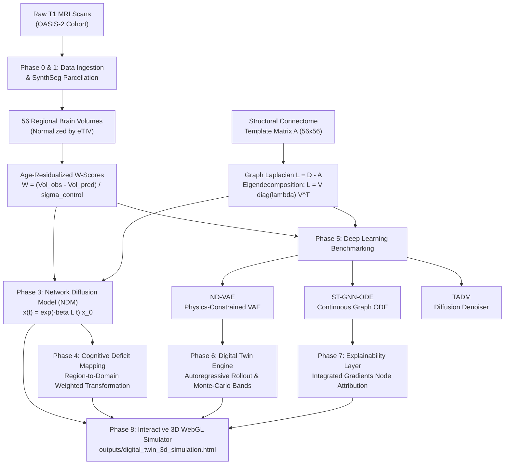

# FUNCTIONAL DESIGN (FD) DOCUMENT
## Longitudinal Neurodegeneration Progression Modeling & 3D Brain Digital Twin

**Project Name:** AD-CELLTWIN / OASIS-2 Longitudinal Digital Twin  
**Target Dataset:** OASIS-2 (Open Access Series of Imaging Studies: Longitudinal MRI in Older Adults)  
**System Classification:** Neuroinformatics, Spatio-Temporal Deep Learning, Network Diffusion Physics, WebGL Digital Twin  
**Document Type:** Functional Design Specification & Architectural Reference  

---

## 1. Executive Summary & Core Research Objective

Neurodegenerative diseases such as Alzheimer's Disease (AD) do not spread randomly across the brain; they follow stereotypical pathways governed by the brain's structural wiring (the structural connectome). Traditional clinical diagnostics evaluate patients cross-sectionally (at a single snapshot in time), making it difficult to foresee *when* and *where* pathology will spread next.

### The Two Fundamental Clinical Questions This System Answers:
1. **What brain regions are currently affected?** (Anatomical localization, age-adjusted volume loss quantification).
2. **What brain regions will be affected next, and what cognitive faculties will decline?** (Multi-year longitudinal forward-simulation over structural connectome tracts).

This platform combines:
- **Structural Neuroimaging:** SynthSeg automated parcellation of T1-weighted MRIs into 56 Desikan-Killiany cortical parcels and subcortical nuclei.
- **Biophysical Network Modeling:** The Network Diffusion Model (NDM) simulating pathology spread as heat-kernel diffusion on structural connectome graphs.
- **Spatio-Temporal Deep Learning:** Spatio-Temporal Graph Neural ODEs (ST-GNN-ODE), Physics-Constrained Variational Autoencoders (ND-VAE), and Trajectory-Aware Diffusion Models (TADM).
- **Clinical Deficit Mapping:** Translation of localized anatomical degeneration into 11 validated cognitive domain impairments.
- **Standalone 3D Brain Digital Twin:** An interactive WebGL simulation rendering multi-year anatomical and cognitive progression with synchronized continuous colormaps and playback controls.

---

## 2. End-to-End System Pipeline Flow

---

## 3. Mathematical & Biophysical Principles

### 3.1 Age-Normalized W-Scores (Residual Volumetrics)
Raw brain volumes decline naturally with healthy aging. Evaluating Alzheimer's atrophy using raw volumes or simple $z$-scores conflates normal senescence with pathological neurodegeneration.
For each region $i$, an Ordinary Least Squares (OLS) regression is fitted exclusively on healthy non-demented controls:
$$\text{ExpectedVolume}_{i}(\text{Age}, \text{Sex}, \text{eTIV}) = \alpha_i + \beta_{\text{age}, i} \cdot \text{Age} + \beta_{\text{sex}, i} \cdot \text{Sex} + \beta_{\text{eTIV}, i} \cdot \text{eTIV}$$

The patient's deviation (W-score) represents standard deviations below age-expected volume:
$$W_i = \frac{\text{ExpectedVolume}_i - \text{ObservedVolume}_i}{\sigma_{\text{residuals, control}}}$$
- $W \le 0$: Healthy volume (at or above age-expected average).
- $W \approx +1.0$: Mild atrophy (1 standard deviation below normal).
- $W \approx +2.0$: Moderate atrophy (2 standard deviations below normal).
- $W \ge +3.0$: Severe pathological neurodegeneration (3 standard deviations below normal).

### 3.2 Network Diffusion Model (NDM) on Graph Laplacians
Pathology (tau neurofibrillary tangles and trans-synaptic degeneration) propagates along structural axonal pathways.
Let $\mathbf{A} \in \mathbb{R}^{56 \times 56}$ be the structural connectome adjacency matrix. The unnormalized graph Laplacian is:
$$\mathbf{L} = \mathbf{D} - \mathbf{A}, \quad D_{ii} = \sum_j A_{ij}$$

The diffusion differential equation governing regional concentration $\mathbf{x}(t)$ is:
$$\frac{d\mathbf{x}}{dt} = -\beta \mathbf{L} \mathbf{x}(t)$$

Given eigendecomposition $\mathbf{L} = \mathbf{V} \mathbf{\Lambda} \mathbf{V}^T$, the closed-form analytical solution is computed efficiently in $O(N^2)$:
$$\mathbf{x}(t) = \exp(-\beta \mathbf{L} t) \mathbf{x}(0) = \mathbf{V} \operatorname{diag}\left(e^{-\beta \lambda_i t}\right) \mathbf{V}^T \mathbf{x}(0)$$
Where $\beta$ is the subject's fitted axonal diffusivity constant. In active neurodegeneration, disease progression includes both connectome diffusion and additive longitudinal progression:
$$\mathbf{x}_{\text{sim}}(t) = \exp(-\beta \mathbf{L} t) \mathbf{x}_0 + \mathbf{r}_{\text{prog}} \cdot t \cdot \left(1 + \frac{\max(0, \mathbf{x}_0)}{2}\right)$$

### 3.3 Cognitive Deficit Mapping
Local atrophy translates directly into functional cognitive impairment through known neurofunctional circuits:
$$\text{Deficit}_d = \frac{\sum_{i=1}^N W_i \cdot \omega_{i, d}}{\sum_{i=1}^N \omega_{i, d}}$$
Where $\omega_{i, d}$ is the clinical mapping weight between anatomical parcel $i$ and cognitive domain $d \in \{\text{Episodic Memory}, \text{Executive Function}, \text{Language}, \text{Visuospatial}, \dots\}$.

---

## 4. Comprehensive File-by-File & Function-by-Function Reference

### Module 1: Data Ingestion & Preprocessing
#### File: `src/oasis2/data/ingest.py`
| Function | Description |
| :--- | :--- |
| `find_demographic_csv(raw_dir)` | Recursively discovers OASIS-2 longitudinal spreadsheets (`.csv` or `.xlsx`) in the raw data directory. |
| `load_demographic_csv(path)` | Parses demographic data, validates mandatory columns (`Subject ID`, `Visit`, `CDR`, `MMSE`), and cleans values. |
| `find_nifti_or_analyze(session_dir)` | Locates T1-weighted neuroimaging files (`.nii`, `.nii.gz`, or Analyze `.img`/`.hdr`). |
| `convert_analyze_to_nifti(img_path)` | Converts legacy Analyze format 3D volumes into modern compressed NIfTI format using NiBabel. |
| `batch_convert_analyze(raw_dir)` | Batch converts all raw MRI volumes in parallel across all subjects and visits. |
| `data_quality_report(demo_df)` | Generates Phase 0 audit: tracks missing visits, CDR transition counts, and exclusion criteria. |
| `build_subjects_index(raw_dir, demo_df)` | Compiles master `subjects_index.csv` merging scan filepaths with longitudinal clinical labels. |

#### File: `src/oasis2/data/synthseg.py`
| Function | Description |
| :--- | :--- |
| `synthseg_available()` | Checks system PATH to verify if the standalone `mri_synthseg` binary is installed. |
| `run_synthseg_single(input_path, out_dir)` | Executes SynthSeg deep-learning whole-brain segmentation on a single scan to produce regional volumes. |
| `run_synthseg_batch(subjects_index)` | Orchestrates multi-threaded or GPU-accelerated parcellation across all longitudinal scans. |
| `aggregate_volumes(synthseg_outputs_dir)` | Compiles individual scan volumetrics into a master table normalized by estimated Total Intracranial Volume (eTIV). |
| `extract_fsl_seg_volumes(fsl_dir)` | Fallback parser extracting tissue compartment volumes from pre-computed FSL FAST/FIRST masks. |

#### File: `src/oasis2/data/datasets.py`
| Function | Description |
| :--- | :--- |
| `LongitudinalGraphDataset` (Class) | PyTorch `Dataset` packaging longitudinal sequences into tensors: `node_features` $(K, N, D)$, `times` $(K)$, `covariates` $(C)$, `adj` $(N, N)$, and clinical scores (`CDR`, `MMSE`). |
| `collate_longitudinal(batch)` | Custom PyTorch collator padding variable-visit patient sequences into batched tensors with boolean masking. |
| `build_dl_datasets(demo_df, w_scores, ...)` | Creates strict subject-level train/validation/test data loaders ensuring zero subject overlap across splits. |

---

### Module 2: Structural Connectome & Network Diffusion (NDM)
#### File: `src/oasis2/connectome.py`
| Function | Description |
| :--- | :--- |
| `CONNECTOME_REGIONS` | The standardized 56 anatomical parcels (34 Left Cortical, 10 Subcortical, 12 Right Cortical). |
| `build_synthetic_connectome(n_regions, seed)` | Generates a biologically plausible fallback connectome with small-world topology and medial temporal hub density. |
| `load_template_connectome(connectome_path)` | Loads reference structural connectome matrix (from HCP template or processed numpy cache). |
| `compute_laplacian(A)` | Computes normalized graph Laplacian $\mathbf{L} = \mathbf{D} - \mathbf{A}$ ensuring symmetry and positive semi-definiteness. |
| `eigen_decompose_laplacian(L)` | Performs eigendecomposition $\mathbf{L} = \mathbf{V} \mathbf{\Lambda} \mathbf{V}^T$ once and caches eigenvalues/eigenvectors. |
| `ndm_propagate(x0, t, beta, evals, evecs)` | Computes closed-form analytical heat diffusion $\mathbf{x}(t) = \mathbf{V} \operatorname{diag}(e^{-\beta \mathbf{\Lambda} t}) \mathbf{V}^T \mathbf{x}_0$ in $O(N^2)$ time. |

#### File: `src/oasis2/ndm.py`
| Function | Description |
| :--- | :--- |
| `compute_w_scores(vol_df, demo_df, ...)` | Residualizes raw regional volumes against age, sex, and eTIV using control regressions to compute W-scores. |
| `fit_beta(x0, x_t, t, evals, evecs)` | Uses bounded 1D scalar optimization (`scipy.optimize.minimize_scalar`) to find subject-specific diffusivity $\beta$. |
| `fit_all_betas(w_scores, evals, evecs, ...)` | Fits individual $\beta$ diffusivities across all subjects with $\ge 2$ visits and outputs `fitted_betas.csv`. |
| `predict_future_atrophy(w_scores, betas, ...)` | Propagates baseline pathology forward 5 years to predict longitudinal atrophy maps. |
| `validate_ndm(w_scores, betas, ...)` | Evaluates NDM predictive accuracy (Pearson $r$, MAE, RMSE) against observed follow-up scans. |
| `run_phase3(regional_volumes, demo_df, ...)` | Orchestrates Phase 3 pipeline: computes W-scores, fits betas, predicts 5-year trajectories, and saves artifacts. |

---

### Module 3: Deficit Mapping & Clinical Risk
#### File: `src/oasis2/deficits.py`
| Function | Description |
| :--- | :--- |
| `REGION_DOMAIN_MAP` | Neuroanatomical mapping dictionary connecting 56 parcels to 11 cognitive and behavioral domains. |
| `get_domain_weights(region_name)` | Returns cognitive weights for any brain parcel with fuzzy name-matching support. |
| `compute_deficit_scores(atrophy_vec, ...)` | Computes weighted average impairment per cognitive domain from regional atrophy vectors. |
| `build_longitudinal_deficit_df(...)` | Builds longitudinal deficit progression trajectories across all cohort visits. |
| `validate_deficits(deficit_df, demo_df)` | Validates functional relevance by correlating deficit scores against observed clinical MMSE and CDR. |
| `run_phase4(ndm_results, demo_df, ...)` | Executes Phase 4 deficit profiling, validation metrics, and saves `deficit_scores.csv`. |

---

### Module 4: Spatio-Temporal Deep Learning Models
#### File: `src/oasis2/models/st_gnn_ode.py`
| Function / Class | Description |
| :--- | :--- |
| `STGNNODEF(nn.Module)` | The Neural ODE continuous derivative function: $\frac{dh}{dt} = \text{GCN}(h, \mathbf{A}) + \text{MLP}(\text{covariates}, t)$. |
| `STGraphNeuralODE(nn.Module)` | Master architecture integrating continuous ODE integration with graph convolutional feature encoders. |
| `train_st_gnn_ode(...)` | Trains the ST-GNN-ODE model with Adam optimizer, early stopping, and cosine learning rate schedules. |

#### File: `src/oasis2/models/nd_vae.py`
| Function / Class | Description |
| :--- | :--- |
| `PhysicsConstrainedNDVAE(nn.Module)` | Variational Autoencoder enforcing biophysical diffusion loss: encodes trajectory into latent space $\mathbf{z}$, decodes future states, and penalizes deviations from $\frac{dx}{dt} = -\beta \mathbf{L} x$. |
| `encode / reparameterize / decode` | Latent space distribution modeling: $q(\mathbf{z}|\mathbf{x}) = \mathcal{N}(\mu, \sigma^2)$, with reparameterization trick. |
| `physics_loss(recon, times, adj, mask)` | Computes soft physics penalty enforcing graph Laplacian diffusion dynamics across reconstructed visits. |
| `train_nd_vae(...)` | Training loop optimizing joint reconstruction loss, KL divergence, and physics constraint loss. |

#### File: `src/oasis2/models/tadm.py`
| Function / Class | Description |
| :--- | :--- |
| `cosine_beta_schedule(timesteps)` | Schedules noise variances $\beta_t$ for diffusion forward process with improved cosine decay. |
| `ConnectomeDiffusionConditioner` | Conditions the diffusion network on structural connectome eigenvalues, time intervals, and patient covariates. |
| `TrajectoryDenoiser` | Residual U-Net style MLP denoiser predicting noise $\epsilon_\theta$ at arbitrary time horizons. |
| `TADM(nn.Module)` | Trajectory-Aware Diffusion Model simulating non-linear trajectory distributions through reverse diffusion sampling. |
| `train_tadm(...)` | Trains diffusion model predicting reverse diffusion trajectories on held-out subject sequences. |

#### File: `src/oasis2/models/benchmark.py`
| Function | Description |
| :--- | :--- |
| `evaluate_dl_model(model, loader, ...)` | Benchmarks a model on held-out test data measuring regional atrophy RMSE, MAE, Pearson $r$, MMSE MAE, and CDR accuracy. |
| `run_benchmark(...)` | Executes comparative benchmark across all 4 modeling tracks (NDM baseline, ST-GNN-ODE, ND-VAE, TADM) and saves `benchmark_results.csv`. |

---

### Module 5: Digital Twin Engine & Explainability
#### File: `src/oasis2/digital_twin.py`
| Function | Description |
| :--- | :--- |
| `_deterministic_decode(model, ...)` | Decodes directly from posterior mean $\mu$ (skipping stochastic sampling) for stable, reproducible trajectory estimates. |
| `simulate_rollout(model, nf_init, ...)` | Autoregressive forward simulation: predicts visit $t+1$, feeds it back as input, and rolls forward $N$ visits. |
| `generate_confidence_bands(...)` | Monte-Carlo sampling (10-50 samples) computing 5th, 50th, and 95th percentile confidence envelopes for patient projections. |
| `apply_counterfactual(model, ...)` | Hypothesis-generating sensitivity analysis: perturbs clinical covariates (e.g. slowed aging rate) and evaluates change in projected atrophy. |

#### File: `src/oasis2/interpretability.py`
| Function / Class | Description |
| :--- | :--- |
| `NodePredictor(nn.Module)` | Isolates single anatomical node prediction as target objective for attribution algorithms. |
| `SingleInputWrapper(nn.Module)` | Adapter layer enabling Captum's Integrated Gradients to operate on complex graph tensor dictionaries. |
| `TemplateRenderer` | Clinician-facing natural language generator translating raw gradient attributions into human-readable clinical summaries. |
| `compute_node_attribution(...)` | Runs Integrated Gradients back to baseline features to pinpoint which initial brain regions triggered future spread. |

---

### Module 6: 3D WebGL Digital Twin Application
#### File: `scripts/build_3d_simulation.py` & `outputs/digital_twin_3d_simulation.html`
| Function | Description |
| :--- | :--- |
| `build_data()` (Python) | Compiles 56 MNI coordinates, structural connectome edges, patient trajectories, and deficit mappings into inlined JSON. |
| `main()` (Python) | Generates and saves standalone, dependency-free `digital_twin_3d_simulation.html`. |
| `init3D()` (JS) | Initializes WebGL renderer, scene, perspective camera, ambient & directional lighting, and OrbitControls. |
| `createConnectome()` (JS) | Renders 3D structural tract bundles with additive blending connecting high-weight connectome edges. |
| `createNodes()` (JS) | Generates 56 interactive 3D spheres positioned at stereotaxic MNI coordinates. |
| `getAtrophyColor(val)` (JS) | Colormap function mapping W-scores: $\le 0\sigma$ (Cyan) $\to 1.0\sigma$ (Green) $\to 2.0\sigma$ (Amber) $\to \ge 3.0\sigma$ (Red). |
| `getAtrophyCssColor(val)` (JS) | Outputs CSS hex strings identical to Three.js sphere colors for 100% neuron-to-chart synchronization. |
| `updateSimulation()` (JS) | Interpolates continuous time steps, updates 3D sphere scales/colors, and refreshes deficit bars. |
| `updateDeficitsDisplay(...)` (JS) | Renders the 11 cognitive domain bars with synchronized continuous colors and clinical percentage metrics. |
| `updateNodeInspector(val)` (JS) | Updates Active Region Focus panel showing parcel name, hemisphere, and colored simulated atrophy. |
| `updateClinicalCard()` (JS) | Displays selected patient's age, sex, clinical group (Demented/Nondemented), CDR, and NDM diffusivity $\beta$. |
| `togglePlay()` (JS) | Controls timeline animation playback with automatic pausing at Year 5.0 endpoint. |
| `setSimSpeed(speed, btn)` (JS) | Sets simulation speed multiplier (0.5x, 1x, 2x) for deliberate, observable playback. |
| `resetSimulation()` (JS) | Resets the simulation timeline back to Baseline (Year 0.0). |
| `setCameraView(view)` (JS) | Snaps 3D camera to anatomical presets: Superior (top), Anterior (front), Left Lateral, or Isometric. |

---

## 5. Tomorrow's Presentation Guide

### 30-Second Elevator Pitch
> *"Current Alzheimer's diagnosis is a reactive snapshot: an MRI shows damage that has already occurred, but cannot tell clinicians where the disease will travel next. We built a personalized 3D Brain Digital Twin that combines the physics of brain network diffusion with deep-learning graph neural ODEs. Given a single patient MRI, our system models pathology spread across the structural connectome, predicting which brain regions will atrophy over the next five years and translating that directly into projected memory, executive, and language deficits."*

### 5-Slide Presentation Structure
1. **Slide 1 — The Problem:** Clinical Alzheimer's assessments are cross-sectional; neurodegeneration is fundamentally longitudinal and network-driven.
2. **Slide 2 — The Core Architecture:** Automated SynthSeg segmentation $\to$ age-residualized W-scores $\to$ Graph Laplacian diffusion on the structural connectome.
3. **Slide 3 — The Machine Learning Track:** Comparing physics-based NDM against continuous Spatio-Temporal Graph Neural ODEs (ST-GNN-ODE) and Physics-Constrained VAEs.
4. **Slide 4 — Explainability & Deficit Mapping:** Not a black box — Integrated Gradients attributes future decline to baseline driver regions (e.g., Left Hippocampus), while cognitive domain transformations map structural loss to functional deficits.
5. **Slide 5 — Live Digital Twin Demo:** Open `digital_twin_3d_simulation.html`, switch between a healthy control and a progressive AD patient, press **Simulate**, and demonstrate the synchronized spread of atrophy and cognitive decline.
